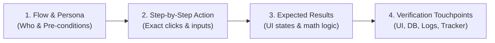

# AMALDINA • ALISONS WMS
## Comprehensive End-to-End Testing Requirements & Demo Runbook

**Document Version:** 2.4.0-PROD  
**Target Application:** Multi-Warehouse Inventory, Reconciliation & Logistics Portal  
**Legal Entity:** Amaldina Comércio Geral, Lda (Luanda, Angola)  
**Production Domain:** [inventory.amaldina.com](https://inventory.amaldina.com)  
**Release Date:** November 2026  

---

## 1. How This Testing & Demo Framework is Structured

To give any team member, QA engineer, or client stakeholder an infallible guide to testing and demonstrating the platform, each feature is modeled across **four rigorous dimensions**:



1. **Flow & Persona (`Who & What`):** Defines the functional capability, the authorized RBAC role, and the required pre-existing state or master data.
2. **Step-by-Step Execution (`How`):** Exact, click-by-click operational actions, form entries, and button clicks.
3. **Expected Results (`What Happens`):** Immediate UI feedback, state transitions, toast messages, and mathematical calculations.
4. **Verification Touchpoints (`Where to Verify`):** The exact touchpoints where the side-effects of the action can be audited and proven:
   - 🖥️ **Front-End View:** Where the updated state renders for the operator.
   - 🔍 **Universal Activity Tracker (`Cmd+K`):** How to inspect the generated `REQ-`, `CNT-`, or `TR-` identifier.
   - 📜 **System Observability Logs (`/admin/logs`):** Correlated HTTP status code, latency, and payload trace.
   - 🗄️ **Database Tables (`PostgreSQL`):** Underlying table names, rows, and mutated columns.

---

## 2. Actor Profiles, Personas & Test Credentials Matrix

All test accounts are pre-seeded in the database with the default password: `admin123`.

| Username | Role Code | Role Name | Assigned Warehouse Hub | Primary Responsibilities & Permitted Actions |
| :--- | :--- | :--- | :--- | :--- |
| `superadmin` | `SUPER_ADMIN` | Global Super Administrator | **HQ / All Hubs** | Unrestricted access across all hubs; RBAC Matrix editor, System Logs, Master Dropdowns, Purge & Seed. |
| `hq.admin` | `HQ_ADMIN` | HQ Executive Director | **HQ / All Hubs** | National stock consolidation across all Angola hubs, inter-warehouse transit overview, audit rollups. |
| `venkatesh.j` | `SUPERVISOR` | Warehouse Supervisor | **Mulemba Hub (Luanda N)** | Approves daily reconciliation, closes audit cycles, dispatches transfers, accepts container cargo. |
| `carlos.m` | `CARTON_STAFF` | Floor Staff (Outer Cartons) | **Mulemba Hub (Luanda N)** | Floor terminal counting of sealed outer master cartons. |
| `antonio.s` | `LOOSE_STAFF` | Floor Staff (Loose Units) | **Mulemba Hub (Luanda N)** | Floor terminal counting of broken/loose boxes and individual bottles. |
| `joao.p` | `DISPLAY_STAFF` | Floor Staff (Showcase Display)| **Mulemba Hub (Luanda N)** | Floor terminal counting of showcase sample display boxes. |
| `manuel.k` | `SUPERVISOR` | Warehouse Supervisor | **Palanca Hub (Luanda S)** | Regional supervisor managing daily reconciliation and stock receipts in Luanda South. |
| `roberto.g` | `SUPERVISOR` | Warehouse Supervisor | **Lobito Hub (Benguela)** | Coastal port depot supervisor managing regional arrivals and inter-branch inbound dispatches. |

---

## 3. Core Business Rules & Mathematical Specifications

### 3.1 The 5-Parameter Daily Reconciliation Ledger Formula
For every pharmaceutical product in an active warehouse audit session:

$$\text{Required Cartons} = \text{Opening Cartons} + \text{Inflow Cartons} - \text{Outflow Transfers Cartons} - \text{Sales Cartons}$$

$$\text{Required Loose} = \text{Opening Loose} + \text{Inflow Loose} - \text{Outflow Transfers Loose} - \text{Sales Loose}$$

$$\text{Required Total Units} = (\text{Required Cartons} \times \text{Units per Carton}) + \text{Required Loose}$$

$$\text{Physical Total Units} = (\text{Physical Cartons} \times \text{Units per Carton}) + \text{Physical Loose} + \text{Physical Display}$$

$$\text{Discrepancy (Variance)} = \text{Physical Total Units} - \text{Required Total Units}$$

- **Zero-Variance ($\Delta = 0$):** Balanced state (Green badge).
- **Negative Variance ($\Delta < 0$):** Physical Shortage / Unaccounted loss (Rose badge).
- **Positive Variance ($\Delta > 0$):** Physical Surplus / Unrecorded return (Amber badge).

### 3.2 Day-to-Day Display Continuity Propagation
Showcase display medicine boxes are physically non-saleable samples. The system enforces:
$$\text{Today's Opening Display} \equiv \text{Yesterday's Closing Display}$$
When a supervisor finalizes session $N$, the closing physical cartons and loose become session $N+1$'s opening stock, and display units carry forward unaltered.

### 3.3 Identification & Trace Prefix Lexicon
- `REQ-YYYYMMDD-<hex>`: Technical correlation trace generated by API middleware for every HTTP request.
- `CNT-2026-XXXX`: Human-readable Floor Count Ticket issued on every count submission.
- `TR-2026-XXXX`: Inter-Warehouse Waybill (Guia de Transferência) number.
- `GRN-2026-XXXX` / `BL-...`: Container bill of lading and customs receipt docket.
- `AUD-YYYYMMDD-<HUB>`: Daily audit cycle session docket number.
- `BAT-YYYY-XXXX`: Pharmaceutical lot/batch tracking identifier.

---

## 4. Complete End-to-End Flow-by-Flow Testing Matrix

---

### Flow 1: Authentication, Multi-Warehouse Switching & Dynamic RBAC
* **Primary Actors:** Any user (`superadmin`, `carlos.m`, `venkatesh.j`, `hq.admin`)
* **Objective:** Verify secure JWT token generation, role-tailored sidebar navigation, and multi-warehouse scope switching.

#### Step-by-Step Test Actions:
1. Open `https://inventory.amaldina.com` (or local `http://localhost:5173`).
2. Verify the login portal displays the official **Amaldina Logo**, entity badge (*Amaldina Comércio Geral, Lda*), and subtitle.
3. In the login form, enter `username: carlos.m` and `password: admin123`. Click **Sign In**.
4. Observe the authenticated view: `carlos.m` is `CARTON_STAFF` — the sidebar displays **only** Floor Counting and Overview. Admin menus (Roles, Lookups, Logs) are hidden.
5. Click the user profile icon at the bottom of the sidebar and click **Sign Out**.
6. Log in as `venkatesh.j` (`password: admin123`).
7. Observe that supervisor controls (Daily Reconciliation, Arrivals & Transfers, Product Catalog, Differences & Expiry) are now visible.
8. Click the **Warehouse Selector** dropdown in the top navbar and toggle from **Mulemba (Luanda North)** to **Palanca (Luanda South)**.

#### Expected Results:
- JWT token `allisons_token` stored in browser `localStorage`.
- Role-based access control automatically restricts/enables sidebar routes based on user permission level.
- Toggling warehouse updates the active context and triggers reactive reload of catalog stocks and sessions.

#### Where to Verify:
* 🖥️ **UI:** Top navbar warehouse badge changes immediately; sidebar renders role-specific section headers.
* 📜 **API Logs (`/admin/logs`):** `POST /api/v1/auth/login` returning HTTP 200 with `request_id: REQ-...` and user payload.
* 🗄️ **Database:** Query `SELECT * FROM users WHERE username = 'carlos.m';` confirms last active warehouse ID.

---

### Flow 2: Pharmaceutical Product Master & Bulk Onboarding (Excel/CSV & Inline Quick-Add)
* **Primary Actors:** `superadmin` or `SUPERVISOR` (`venkatesh.j`)
* **Objective:** Verify catalog management, category filtering, CSV/Excel bulk upload, and live SKU creation.

#### Step-by-Step Test Actions:
1. Navigate to **Operations & Logistics > Product Catalog** (`/products`).
2. Verify the 52 official products from the *Amaldina Price List* are listed with therapeutic categories (e.g., Antibiotics, Analgesics, Antimalarials).
3. Test search: Type `ALAIZE` in the search bar. Verify `ALIS-ALAIZE-01` (*ALAIZE Suspensão Oral 100ml*, 100 units/carton) appears.
4. Click **+ Quick Add Product**.
5. Fill in the modal:
   - SKU: `ALIS-TEST-99`
   - Description: `AMALDINA TEST AMPICILINA 500MG`
   - Category: `Antibióticos`
   - Units per Carton: `50`
   - Unit Price (AOA): `2450.00`
6. Click **Save Product**.
7. Test Export: Click **Export Catalog (CSV)**. Verify file `Alisons_Pharmaceutical_Catalog_YYYY-MM-DD.csv` downloads.

#### Expected Results:
- Product is added to the active catalog without page refresh.
- Newly added SKU is immediately available in the Floor Counting and Arrivals dropdowns.

#### Where to Verify:
* 🖥️ **UI:** Product Catalog table updates to 53 products; search finds `ALIS-TEST-99`.
* 🔍 **Tracker Modal (`Cmd+K`):** Press `Cmd+K`, type `ALIS-TEST-99`. Product SKU card appears with category and packaging details.
* 🗄️ **Database:** Query `SELECT * FROM products WHERE sku = 'ALIS-TEST-99';` confirms record.

---

### Flow 3: Inward Ocean Logistics & Container Receipt (Port Inflow / GRN)
* **Primary Actors:** `SUPERVISOR` (`venkatesh.j` - Mulemba)
* **Objective:** Record an ocean freight arrival at Luanda Port, receive cargo, and verify automated stock injection into reconciliation.

#### Step-by-Step Test Actions:
1. Navigate to **Operations & Logistics > Arrivals & Transfers** (`/shipments`).
2. Under the **Ocean & Inward Cargo** tab, click **+ Register New Arrival**.
3. Fill in the container logistics details:
   - Port / Origin: `Port of Luanda (Terminal de Carga)`
   - Container Number: `MSKU-778899-2`
   - Bill of Lading (B/L): `BL-MSCU-2026-9901`
   - Commercial Invoice: `INV-2026-ALIS-441`
   - Freight Type: `40ft High Cube Container`
   - Expected Arrival Date: Select today's date.
4. Add Line Item:
   - Select Product: `ALAIZE Suspensão Oral (ALIS-ALAIZE-01)`
   - Cartons Received: `50`
   - Shortage / Damaged Cartons: `0`
   - Batch / Lot: `BAT-2026-INW01`
   - Expiry Date: `2028-11-30`
5. Click **Confirm Arrival Registration**.
6. Find the new arrival in the table (Status: `ARRIVED_AT_PORT`) and click **Receive into Stock**.

#### Expected Results:
- Container status changes to `RECEIVED_INTO_WAREHOUSE`.
- Goods Receipt Note docket generated.
- The 50 cartons ($\times 100\text{ units/carton} = 5,000\text{ units}$) are automatically credited to today's Daily Reconciliation ledger under **Inflow Cartons**.

#### Where to Verify:
* 🖥️ **Daily Reconciliation (`/reconciliation`):** Look up `ALIS-ALAIZE-01` — **Inflow Cartons** shows `50` ($+5,000$ units).
* 🔍 **Tracker Modal (`Cmd+K`):** Type `BL-MSCU-2026-9901` or `MSKU-778899-2`. Arrival card displays with status `RECEIVED_INTO_WAREHOUSE`.
* 📜 **API Logs:** `POST /api/v1/shipments/arrivals/new` logged with HTTP 200.
* 🗄️ **Database:** `SELECT * FROM shipment_arrivals WHERE container_number = 'MSKU-778899-2';`.

---

### Flow 4: Inter-Warehouse Transfer & Dispatch (Transfer Note / Waybill with Logo)
* **Primary Actors:** `SUPERVISOR` (`venkatesh.j` - Mulemba dispatcher, `roberto.g` - Lobito receiver)
* **Objective:** Create inter-branch stock dispatch, generate printable official Waybill (*Guia de Transferência*) with Amaldina logo, and complete receiving at destination.

#### Step-by-Step Test Actions:
1. While logged in as `venkatesh.j` (Mulemba), navigate to **Arrivals & Transfers > Inter-Warehouse Transfers** tab.
2. Click **+ Create Transfer Note**.
3. Form entry:
   - Destination Warehouse: `Lobito Warehouse (Benguela)`
   - Driver Name: `Mateus Fernandes`
   - Vehicle Plate: `LD-44-91-GA`
   - Transport Company: `Amaldina Frota Interna`
4. Add Line Item:
   - Product: `ALAIZE Suspensão Oral (ALIS-ALAIZE-01)`
   - Cartons to Dispatch: `10` ($1,000\text{ units}$)
   - Loose Units: `0`
5. Click **Create Transfer**.
6. The system generates Waybill Number `TR-2026-XXXX`. Click the **Print** icon.
7. Verify the printable transfer modal:
   - Official **Amaldina Logo** rendered on top left.
   - Company title: *Amaldina Comércio Geral, Lda — Alisons WMS Division*.
   - Destination branch highlighted: *Transfer Note for Amaldina Comercio Geral, Lda – Lobito*.
   - Signature boxes for Dispatched By, Driver Signature, and Received By.
8. Click **Dispatch Transfer** (Status becomes `IN_TRANSIT`).
9. Switch user: Sign out and log in as `roberto.g` (Lobito Warehouse).
10. Open **Arrivals & Transfers > Inter-Warehouse Transfers**, locate the incoming transfer `TR-2026-XXXX`, and click **Confirm Receipt**.

#### Expected Results:
- Source warehouse (Mulemba) records $-10$ cartons in **Outflow Transfers**.
- Destination warehouse (Lobito) records $+10$ cartons in **Inflow Transfers**.
- Waybill status moves: `DRAFT` $\rightarrow$ `IN_TRANSIT` $\rightarrow$ `RECEIVED`.

#### Where to Verify:
* 🖥️ **Mulemba Reconciliation:** Outflow column for `ALIS-ALAIZE-01` shows `10`.
* 🖥️ **Lobito Reconciliation:** Inflow column for `ALIS-ALAIZE-01` shows `10`.
* 🔍 **Tracker Modal (`Cmd+K`):** Type `TR-2026-`. Waybill details appear with transit route and timestamp.
* 🗄️ **Database:** `SELECT transfer_number, status FROM transfers WHERE transfer_number = 'TR-2026-XXXX';`.

---

### Flow 5: Tri-Level Physical Floor Stock Counting Terminal
* **Primary Actors:** `carlos.m` (Carton Staff), `antonio.s` (Loose Staff), `joao.p` (Display Staff)
* **Objective:** Floor operators tally physical stock across three packaging levels; system issues official Count Ticket (`CNT-2026-XXXX`) and correlates API trace (`REQ-XXXX`).

#### Step-by-Step Test Actions:
1. Log in as `carlos.m` (Carton Staff). Navigate to **Floor Counting** (`/counts`).
2. Select Product: `ALAIZE Suspensão Oral (ALIS-ALAIZE-01)`.
   - Observe packaging indicator: *"Units per Carton: 100"*.
3. Select Count Mode: **Outer Master Cartons**.
4. Enter Count Value: `40` cartons.
5. Enter Batch Number: `BAT-2026-X1`.
6. Enter Expiry Date: `2027-10-31`.
7. Enter Damaged Units: `0`.
8. Click **Submit Physical Count**.
9. Observe the confirmation toast: displays **Count Ticket Number: `CNT-2026-XXXX`** and **Trace ID: `REQ-XXXX`** with copy button.
10. Log out and log in as `antonio.s` (Loose Staff).
11. Submit count for same product: Select **Broken / Loose Units**, enter `15` units. Submit.
12. Log out and log in as `joao.p` (Display Staff).
13. Submit count for same product: Select **Showcase Display Units**, enter `5` units. Submit.

#### Expected Results:
- Each submission issues a unique `CNT-2026-XXXX` ticket number.
- Total Physical Equivalent Units automatically calculates:
  $$\text{Physical Units} = (40 \times 100) + 15 + 5 = 4,020\text{ units}$$
- Counts are immediately aggregated into the active Daily Reconciliation Sheet.

#### Where to Verify:
* 🖥️ **Recent Counts Table (`/counts`):** All 3 submissions appear with tickets, timestamps, and staff names.
* 🔍 **Tracker Modal (`Cmd+K`):** Paste the generated `CNT-2026-XXXX`. Instant ticket card displays count breakdown.
* 📜 **API Logs:** `POST /api/v1/counts/submit` logged with ticket number in response.
* 🗄️ **Database:** `SELECT ticket_number, count_type, entered_units, total_units FROM physical_counts ORDER BY id DESC LIMIT 3;`.

---

### Flow 6: 5-Parameter Daily Stock Reconciliation Ledger & Variance Engine
* **Primary Actors:** `SUPERVISOR` (`venkatesh.j` - Mulemba)
* **Objective:** Audit the dynamic mathematical balance of Required Stock vs. Physical Stock and evaluate live variance.

#### Step-by-Step Test Actions:
1. Log in as `venkatesh.j`. Navigate to **Daily Reconciliation** (`/reconciliation`).
2. Ensure Date is set to today and Warehouse is **Mulemba**.
3. Locate row for `ALAIZE Suspensão Oral (ALIS-ALAIZE-01)`.
4. Review the 5 mathematical columns:
   - **Opening Stock:** `0` cartons | `0` loose
   - **Inflow (From Container):** `50` cartons ($+5,000$ units)
   - **Outflow (Transfer to Lobito):** `10` cartons ($-1,000$ units)
   - **Theoretical Required Stock:**
     $$\text{Req Cartons} = 0 + 50 - 10 = 40\text{ cartons}$$
     $$\text{Req Loose} = 0\text{ loose}$$
     $$\text{Req Total Units} = (40 \times 100) + 0 = 4,000\text{ units}$$
   - **Physical Counted Stock:**
     $$\text{Physical Cartons} = 40\text{ cartons}$$
     $$\text{Physical Loose} = 15\text{ units}$$
     $$\text{Physical Display} = 5\text{ units}$$
     $$\text{Physical Total Units} = (40 \times 100) + 15 + 5 = 4,020\text{ units}$$
   - **Discrepancy (Variance):**
     $$\Delta = 4,020 - 4,000 = +20\text{ units (Surplus / Excedente)}$$
5. Observe the status pill: Displays amber `+20 Units Surplus` (Excedente de 20 unidades).

#### Expected Results:
- Mathematical calculations update dynamically in real time without page reload.
- Formula matches standard pharma audit compliance with complete carton-to-unit consistency.

#### Where to Verify:
* 🖥️ **UI:** Reconciliation grid row for `ALIS-ALAIZE-01` displays exact values.
* 🗄️ **Database:** `SELECT opening_cartons, inflow_cartons, outflow_transfers_cartons, physical_cartons, physical_loose, physical_display, variance_units FROM daily_reconciliation_records WHERE product_id = (SELECT id FROM products WHERE sku = 'ALIS-ALAIZE-01');`.

---

### Flow 7: Audit Session Closing & Day-to-Day Display Continuity Propagation
* **Primary Actors:** `SUPERVISOR` (`venkatesh.j` - Mulemba)
* **Objective:** Finalize the daily audit session and verify display continuity carry-forward into the next business day.

#### Step-by-Step Test Actions:
1. In **Daily Reconciliation** (`/reconciliation`), click **Finalize Daily Audit Session**.
2. Review the session closing summary:
   - Total products audited
   - Balanced products count vs Discrepancies count
   - Cycle docket number: `AUD-YYYYMMDD-MULEMBA`
3. Enter Closing Audit Notes: *"Daily physical audit completed. Verified +20 surplus in Alaize due to promotional sample packs. Approved."*
4. Click **Confirm & Close Audit Session**.
5. Switch the Date selector at top to tomorrow's date.
6. Locate `ALIS-ALAIZE-01` in tomorrow's reconciliation sheet.

#### Expected Results:
- Today's session status changes from `OPEN` to `FINALIZED`.
- Tomorrow's session initializes automatically with:
  - **Opening Cartons:** `40`
  - **Opening Loose:** `15`
  - **Opening Display:** `5` (Display Continuity Rule satisfied).

#### Where to Verify:
* 🖥️ **UI:** Banner on finalized session states *"Audit Session Finalized & Locked by Carlos Supervisor"*.
* 🔍 **Tracker Modal (`Cmd+K`):** Type `AUD-`. Session docket displays with status `FINALIZED`.
* 🗄️ **Database:** `SELECT id, session_date, status, audit_cycle_number FROM inventory_sessions ORDER BY id DESC LIMIT 2;`.

---

### Flow 8: Discrepancy Investigation, FEFO Expiry Tracking & Quality Quarantine
* **Primary Actors:** `SUPERVISOR` or `HQ_ADMIN`
* **Objective:** Investigate variance alerts and audit the First-Expired First-Out (FEFO) batch matrix.

#### Step-by-Step Test Actions:
1. Navigate to **Alerts & Quality > Differences & Expiry** (`/alerts`).
2. Tab 1: **Variance & Discrepancies Radar**:
   - Locate the $+20$ surplus alert for `ALIS-ALAIZE-01`.
   - Click **Investigate / Add Justification**.
   - Select Reason: `SAMPLES_INCLUDED_IN_BOX` (from dynamic lookups).
   - Click **Acknowledge & Save**.
3. Tab 2: **FEFO Expiry Management**:
   - Filter by status: `<90 Days (Near Expiry)`.
   - Inspect batch cards: Displays batch number, warehouse location, days to expiry, and recommended dispatch priority.
   - For any batch expiring in $<30$ days, click **Quarantine Batch** to flag it for quality review.

#### Expected Results:
- Discrepancy note is recorded against the audit session.
- Quarantined batches are restricted from inter-warehouse transfer selection.

#### Where to Verify:
* 🖥️ **UI:** Alert card reflects updated status `ACKNOWLEDGED`.
* 🗄️ **Database:** `SELECT * FROM stock_alerts ORDER BY id DESC LIMIT 5;`.

---

### Flow 9: Executive HQ Master Stock Consolidation (Angola National Rollup)
* **Primary Actors:** `hq.admin` or `superadmin`
* **Objective:** Aggregate multi-warehouse balances across Mulemba, Palanca, and Lobito into a national executive report.

#### Step-by-Step Test Actions:
1. Log in as `hq.admin` (`password: admin123`).
2. Navigate to **HQ Executive > HQ Master Angola Stock** (`/hq`).
3. Inspect Executive Metric Cards:
   - Total National Inventory (Cartons & Equivalent Units)
   - Active Transit Cargo (Between Warehouses)
   - Total Estimated Inventory Value (in AOA)
   - Operational Hub Status (Mulemba, Palanca, Lobito).
4. Review the Consolidated Stock Table:
   - For each SKU, columns show: `Mulemba Stock` | `Palanca Stock` | `Lobito Stock` | `Total Angola Stock`.
5. Test Category Filter: Select `Antibióticos` or `Analgésicos`.
6. Click **Export Master (Print/PDF)**.

#### Expected Results:
- National totals equal the exact sum of all 3 warehouse reconciliation balances.
- Transits in progress appear under the active logistics pipeline card.

#### Where to Verify:
* 🖥️ **UI:** `Total Angola Units` matches Mulemba $+$ Palanca $+$ Lobito.
* 📜 **API Logs:** `GET /api/v1/hq/overview` and `GET /api/v1/hq/master-stock` return aggregated metrics.

---

### Flow 10: Dynamic RBAC Matrix & Tile-Level / Sub-Action Permissions
* **Primary Actors:** `superadmin`
* **Objective:** Reconfigure live role permissions (view/edit/finalize/export) dynamically without altering backend code.

#### Step-by-Step Test Actions:
1. Log in as `superadmin`. Navigate to **System & Audit > Roles & Authorization** (`/roles`).
2. In the Roles list, select `CARTON_STAFF`.
3. In the Permission Matrix:
   - Locate tile **Daily Reconciliation Sheet**.
   - Notice that **Can View** is currently disabled.
   - Toggle **Can View** to **ENABLED**.
4. Click **Save Permission Matrix**.
5. Log out and log in as `carlos.m` (`CARTON_STAFF`).
6. Observe the sidebar: **Daily Reconciliation** now appears in `carlos.m`'s menu!
7. Return to `superadmin`, toggle it back to **DISABLED**, and save.

#### Expected Results:
- Permission changes take effect immediately on next authentication or page navigation.
- Demonstrates true zero-downtime dynamic access control.

#### Where to Verify:
* 🖥️ **UI:** Sidebar reacts dynamically to updated permission state.
* 🗄️ **Database:** `SELECT * FROM tile_role_permissions WHERE role_id = (SELECT id FROM roles WHERE code = 'CARTON_STAFF');`.

---

### Flow 11: Master Dropdowns & Dynamic Lookup Dictionary
* **Primary Actors:** `superadmin`
* **Objective:** Manage dynamic drop-down options for discrepancy reasons, freight modes, and unit types.

#### Step-by-Step Test Actions:
1. While logged in as `superadmin`, navigate to **System & Audit > Master Dropdowns** (`/lookups`).
2. Select Lookup Type: `DISCREPANCY_REASON` (*Motivos de Discrepância*).
3. Click **+ Add Lookup Value**.
4. Enter:
   - Code: `CUSTOMS_SAMPLE_DRAW`
   - Label: `Retirada de Amostra Alfandegária`
   - Description: `Sample bottle taken at Port of Luanda for laboratory analysis`
5. Click **Save Lookup**.
6. Navigate to **Floor Counting** (`/counts`) and open the **Reason Code** dropdown.
7. Verify that *"Retirada de Amostra Alfandegária"* is immediately available in the list!

#### Expected Results:
- Eliminates hardcoded select options across all front-end forms.
- New operational reason codes can be added by business admins in real time.

#### Where to Verify:
* 🖥️ **UI:** New option appears in Floor Counting reason dropdown.
* 🗄️ **Database:** `SELECT * FROM lookup_values WHERE code = 'CUSTOMS_SAMPLE_DRAW';`.

---

### Flow 12: Real-Time API Observability & Request Correlation Tracing
* **Primary Actors:** `superadmin`
* **Objective:** Inspect system health, monitor latency, trace correlated request IDs, and export logs.

#### Step-by-Step Test Actions:
1. Log in as `superadmin`. Navigate to **System & Audit > API Observability Logs** (`/logs`).
2. Inspect the **24-Hour Activity Heatmap** and telemetry cards (Total Calls, Error Rate, Avg Latency).
3. Review the live log stream table:
   - Each row displays: Method, Endpoint, Status Code (200, 401, 500), Duration (ms), Client IP, User, and **Request Trace ID (`REQ-YYYYMMDD-XXXX`)**.
4. Click the **Copy Trace ID** button beside any request.
5. In the Filter box, paste the copied `REQ-...` ID.
6. Verify the table instantly filters to that exact transaction.
7. Click **Export Logs (CSV)** to download the audit trail.

#### Expected Results:
- Complete end-to-end auditability conforming to pharmaceutical GDP (Good Distribution Practice).
- Every user click and background request is logged with its exact correlation ID.

#### Where to Verify:
* 🖥️ **UI:** Filtered log row matches copied Trace ID.
* 🗄️ **Database:** `SELECT * FROM api_logs ORDER BY id DESC LIMIT 5;`.

---

### Flow 13: Universal Activity & Audit Inspector (`Cmd+K` / `Ctrl+K`)
* **Primary Actors:** All Users (Global Shortcut)
* **Objective:** Verify instant global search across disparate entities using unified tracking numbers.

#### Step-by-Step Test Actions:
1. From any page in the application, press <kbd>Ctrl</kbd> + <kbd>K</kbd> (or <kbd>Cmd</kbd> + <kbd>K</kbd> on macOS), or click the top search pill.
2. In the search input, try the following test searches:
   - Search `ALIS-ALAIZE`: Displays matched Product SKU card, carton packaging, and category.
   - Search `TR-2026-`: Displays all matching Inter-Warehouse Transfer Waybills with route and status.
   - Search `CNT-2026-`: Displays Floor Count Tickets with author and counted quantities.
   - Search `REQ-`: Displays matching technical request traces.
3. In any result card, click the **1-Click Copy** button to copy the identifier.
4. Click the **Navigate to View** link (e.g. on a Transfer result).

#### Expected Results:
- Modal opens smoothly with keyboard shortcut and closes on <kbd>ESC</kbd>.
- Debounced API search returns instant results grouped with color-coded category icons.
- Deep links transport the operator directly to the target record.

#### Where to Verify:
* 🖥️ **UI:** Search modal renders cleanly with instant auto-focus and copy toasts.
* 📜 **API Logs:** `GET /api/v1/tracking/inspect?q=...` logged with sub-50ms latency.

---

### Flow 14: Bilingual Localization (Português-Angola `🇦🇴 PT` vs English `🇬🇧 EN`)
* **Primary Actors:** All Users (Global Navbar Toggle)
* **Objective:** Test seamless 1-click internationalization between Portuguese and English.

#### Step-by-Step Test Actions:
1. Observe the language switch button in the top navbar: displays `🇦🇴 PT` or `🇬🇧 EN`.
2. Click the language button to toggle to **`🇦🇴 PT` (Português de Angola)**.
3. Observe immediate DOM re-rendering:
   - Navigation: *Painel de Controlo*, *Contagem Física*, *Folha de Reconciliação Diária*, *Entradas e Transferências*, *Catálogo de Produtos*.
   - Table headers: *Stock Teórico*, *Contagem Física*, *Diferença*, *Armazém*.
   - Status badges: *Balanceado*, *Excedente*, *Em Trânsito*, *Recebido*.
4. Refresh the browser page (`F5`).
5. Verify language preference persists in `localStorage` (`allisons_lang`).
6. Click the toggle again to return to `🇬🇧 EN`.

#### Expected Results:
- 100% of UI labels, table headers, form placeholders, and status badges translate instantly without backend round-trip.

#### Where to Verify:
* 🖥️ **UI:** Entire application adapts to Angolan Portuguese terminology.
* 🗄️ **Browser:** `localStorage.getItem("allisons_lang")` stores `"pt"` or `"en"`.

---

## 5. Structured 20-Minute Client Demo Script (Storyline Walkthrough)

When presenting this application to stakeholders, executives, or the Amaldina warehouse operations team, follow this chronological storytelling sequence:

```
[00:00 - 03:00]  ACT 1: Corporate Identity & Secure Multi-Role Portal
                 - Show Amaldina branding, logo, and multi-warehouse selector.
                 - Log in as Carlos (Floor Staff) vs Venkatesh (Supervisor) to demonstrate RBAC.

[03:00 - 07:00]  ACT 2: Inbound Container Arrival & Product Master
                 - View 52 official products in Product Catalog.
                 - Receive 50 cartons of Alaize from ocean vessel (MSKU container at Luanda Port).

[07:00 - 11:00]  ACT 3: Floor Counting Terminal & Ticket Generation
                 - Perform live count in Outer Cartons, Loose Units, and Display Boxes.
                 - Highlight auto-generated Count Ticket (CNT-2026-XXXX) and Trace ID (REQ-XXXX).

[11:00 - 15:00]  ACT 4: The 5-Parameter Daily Reconciliation Ledger
                 - Show live math: Opening (0) + Inflow (50) - Outflow (10) vs Physical (40 cartons + 20 units).
                 - Explain the +20 Surplus calculation and Display Continuity rule.
                 - Finalize session with supervisor audit notes.

[15:00 - 18:00]  ACT 5: Inter-Warehouse Dispatch & Official Waybill
                 - Dispatch 10 cartons from Mulemba to Lobito (Benguela).
                 - Open printable Transfer Note (Guia de Transferência) with Amaldina logo and NIF.

[18:00 - 20:00]  ACT 6: Executive HQ Master View & Universal Search
                 - Log in as HQ Admin: Show Angola-wide stock consolidation across all 3 hubs.
                 - Press Ctrl+K to demonstrate instant tracking of tickets, waybills, and SKUs.
```

---

## 6. QA Acceptance Sign-Off Checklist

| Test Flow # | Operational Flow Name | Tested By | Date Tested | Status (PASS/FAIL) | Notes / Observations |
| :---: | :--- | :--- | :--- | :---: | :--- |
| **01** | Authentication & RBAC Scope | | | `[   ]` | |
| **02** | Product Catalog & Bulk Upload | | | `[   ]` | |
| **03** | Ocean Freight & Container Inflow | | | `[   ]` | |
| **04** | Inter-Warehouse Transfer & Waybill | | | `[   ]` | |
| **05** | Floor Physical Counting Terminal | | | `[   ]` | |
| **06** | 5-Parameter Reconciliation Engine | | | `[   ]` | |
| **07** | Session Closing & Display Continuity | | | `[   ]` | |
| **08** | Discrepancies & FEFO Expiry Radar | | | `[   ]` | |
| **09** | Executive HQ Angola Master Stock | | | `[   ]` | |
| **10** | Dynamic RBAC Permission Matrix | | | `[   ]` | |
| **11** | Master Dropdowns & Lookups | | | `[   ]` | |
| **12** | API Observability & Request Traces | | | `[   ]` | |
| **13** | Universal Activity Tracker (`Cmd+K`) | | | `[   ]` | |
| **14** | Bilingual Localization (`PT` / `EN`) | | | `[   ]` | |

**Sign-off Approvals:**  
- **Lead QA Engineer:** ___________________________  Date: ______________  
- **Warehouse Operations Lead:** ___________________  Date: ______________  
- **Project Stakeholder (Amaldina):** _______________  Date: ______________  
